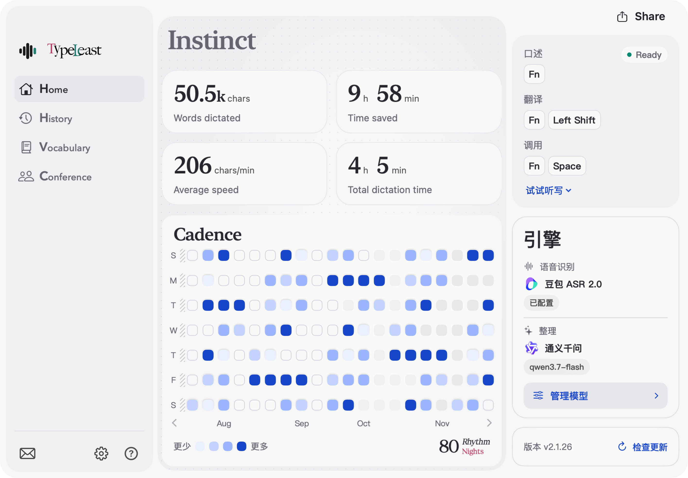
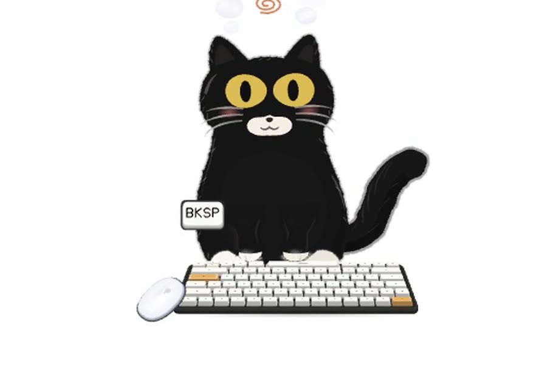

<h1 align="center">TypeLeast</h1>

<p align="center">Press Fn, speak, then press again. A clean draft appears at the cursor.</p>

<p align="center">
  <a href="https://github.com/FlaxXTT/Typeleast/releases/latest"><strong>Download for macOS</strong></a> ·
  <a href="https://typeleast.promptking.workers.dev/">Website</a> ·
  <a href="https://www.bilibili.com/video/BV1eQnH6zESN/">Bilibili</a> ·
  <a href="README.md">简体中文</a>
</p>

<p align="center">
  
</p>

<p align="center"><sub>Open source · Apple silicon · macOS 14 or later</sub></p>

<p align="center">
  
</p>

### See it in 41 seconds

<a href="docs/media/readme/typeleast-overview.mp4"></a>

[Watch or download the MP4 (Mandarin narration)](docs/media/readme/typeleast-overview.mp4)

| Shortcut | What it does |
| --- | --- |
| **Fn** | Dictate and insert the cleaned-up text at the cursor. |
| **Fn + Left Shift** | Translate selected text, or speak Chinese and insert English. |
| **Fn + Space** | Hold to open Harness EQ, choose a Skill or MCP entry, then release to insert it. |

Use a local speech model or bring your own API key. If you enable cloud recognition, cleanup, or translation, the relevant content goes to the provider you choose. [Setup guide](docs/user-guide.en.md) · [Data and privacy](docs/user-guide.en.md#privacy-and-local-data)

### Harness EQ · Archive a Skill

Import Skills and MCP entries under **Settings → Harness EQ**. Pick one from the wheel when you need it.

<details>
<summary>Copy the Skill archival prompt for your agent</summary>

```text
Archive the Skill I specify in TypeLeast → Settings → Harness EQ → Skill. If I haven’t provided a name or path, ask me for it. Work only on the item I specify.

1. Choose Save in TypeLeast for a standalone Skill. For a Skill with dependencies, import a .skill or .zip package with SKILL.md and the required files. Preserve their relative paths, the Skill body, and required fields.
2. Verify that Harness EQ can invoke the archived copy. A standalone Skill should return the full text. A Skill with dependencies should point to the archived SKILL.md and allow its supporting files to be read relative to that file. Read the files for verification without running their scripts or instructions.
3. After verifying, move the specified original to Trash if I explicitly asked you to archive and remove it. Otherwise, ask me: “I verified that the archived copy works through Harness EQ. The original agent may stop auto-loading the old entry. Should I move the original to Trash?”
4. Keep the original and explain why if invocation still depends on the original path, another project references it, or you can’t verify the required files. If you can’t operate TypeLeast, tell me which step to do myself.

Report which Skill you archived, what you verified, and whether you moved the original to Trash.
```

</details>

---

[Changelog](CHANGELOG.md) · [Legacy downloads](docs/user-guide.en.md#legacy-downloads) · [Build from source](apps/macos/README.md#build-test-package) · [Code signing](docs/CODE_SIGNING_POLICY.md) · [Report an issue](https://github.com/FlaxXTT/Typeleast/issues/new) · [GPL-3.0 license](LICENSE)

Thanks to [pioneerAlone](https://github.com/pioneerAlone) ([#107](https://github.com/FlaxXTT/Typeleast/issues/107)) and [tomcatcoffee](https://github.com/tomcatcoffee) ([#179](https://github.com/FlaxXTT/Typeleast/issues/179)) for their issue reports.
