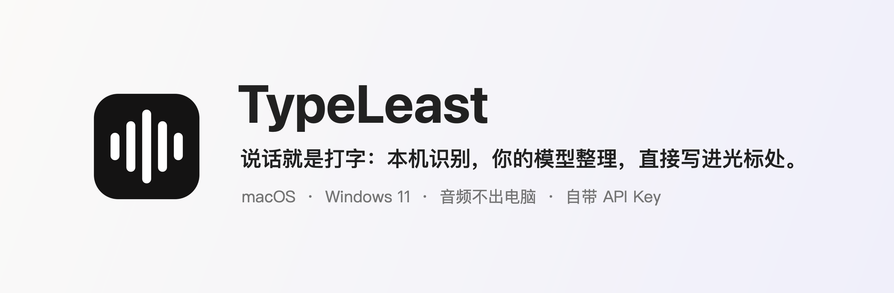
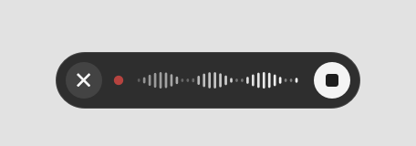

<p align="center">
  
</p>

<p align="center">
  <a href="https://github.com/FlaxXTT/typeleast/releases/latest"></a>
  
  
  
  
</p>

<p align="center">
  <a href="docs/media/promo.mp4"></a>
</p>

<p align="center"><sub>10 秒宣传片（点击看高清 MP4）。</sub></p>

# TypeLeast

按一下快捷键说话，再按一下结束：语音在**你自己的电脑上**识别，再用**你自己的大模型 API Key** 整理成通顺的文字，直接出现在当前光标处。对标 [Typeless](https://www.typeless.com)，但识别不上云，也不用订阅。

## 为什么用 TypeLeast

| | |
|---|---|
| 🎙️ **随口说，它来整理** | 「嗯」「那个」「然后呢」自动去掉；说错了改口（「明天，不对，后天」），它按你最后的意思写；句子理顺、标点补好，不编造你没说的内容。 |
| 🔒 **识别在本机** | SenseVoice 模型在你的电脑上运行（中、英、日、韩、粤），音频不离开你的电脑。 |
| 🔑 **用你自己的模型** | DeepSeek、智谱、Kimi、通义千问、OpenRouter、OpenAI，或本机 Ollama。按量付费，没有订阅；Key 只存在系统钥匙串 / 凭据管理器里。不填 Key 也能用，只去口水词。 |
| ⚡ **哪里都能用** | 微信、邮件、浏览器、Word、VS Code……任何输入框。Mac 单按 fn，Windows 单按右 Alt。 |
| 📦 **装上就能用** | 安装包自带运行环境，不需要账号，也不需要另装 Node.js 或其他宿主程序。 |

## 实际效果

<p align="center">
  
</p>

<p align="center"><sub></sub></p>

## 界面一览

<table>
  <tr>
    <td width="50%"></td>
    <td width="50%"></td>
  </tr>
  <tr>
    <td align="center"><sub>首页：一键开始、统计、最近的听写</sub></td>
    <td align="center"><sub>历史：整理结果和原话都能复制</sub></td>
  </tr>
  <tr>
    <td width="50%"></td>
    <td width="50%"></td>
  </tr>
  <tr>
    <td align="center"><sub>设置：选服务商、填 Key、测试连接</sub></td>
    <td align="center"><sub>词典：人名、术语、「听成=正确写法」，支持深色模式</sub></td>
  </tr>
</table>

<p align="center">
  
  &nbsp;&nbsp;
  
  <br><sub>屏幕底部的录音条：说话时显示实时波形，说完显示整理进度，不抢当前窗口的焦点。</sub>
</p>

<sub>截图里的历史和词典都是示例数据。</sub>

---

## 下载安装（普通用户看这里）

到本仓库的 **Releases** 页面下载最新版本：

| 你的电脑 | 下载这个文件 |
|---|---|
| Mac，Apple 芯片（M1、M2、M3、M4…） | `TypeLeast-<版本>-macOS-AppleSilicon.dmg` |
| Mac，Intel 芯片 | `TypeLeast-<版本>-macOS-Intel.dmg` |
| Windows 11 / Windows 10，64 位 | `TypeLeast-<版本>-Windows-x64-Setup.exe`（安装版），或 `…-Portable.zip`（解压即用） |

> 不确定 Mac 是哪种芯片：点左上角  →「关于本机」，「芯片」一栏写 Apple M… 就是 Apple 芯片，写 Intel 就是 Intel。

安装包里**已经带好** Node.js 和本地识别引擎，不需要另外安装任何东西。`SHA256SUMS.txt` 里有每个文件的校验值。

### 你需要准备的

| | macOS | Windows |
|---|---|---|
| 系统 | macOS 13 Ventura 或更新 | Windows 11，或 Windows 10 1809 及以上（64 位） |
| 磁盘 | 约 450 MB（App 约 200 MB + 语音模型 241 MB） | 约 450 MB（App 约 200 MB + 语音模型 241 MB） |
| 网络 | 第一次打开时下载一次语音模型（约 241 MB）；之后识别完全离线，只有整理时访问你选的模型服务商 | 同左 |
| 权限 | 麦克风；辅助功能（自动粘贴、Fn 键） | 麦克风（系统隐私设置里允许桌面应用访问）；不需要管理员权限 |
| 整理模型 | 任一 OpenAI 兼容服务的 API Key（可选） | 同左 |

### macOS 安装步骤

1. 打开 `.dmg`，把 **TypeLeast** 拖进「应用程序」。
2. 第一次打开会被系统拦下，因为这个版本没有 Apple 开发者签名。打开「系统设置 → 隐私与安全性」，在页面底部点 **「仍要打开」**，再确认一次。
   也可以在「终端」里运行这一行，然后正常打开：

   ```bash
   xattr -dr com.apple.quarantine /Applications/TypeLeast.app
   ```

3. 按新手引导：
   - **本地识别**：点「下载」获取语音模型（约 241 MB，只需一次，带进度）。
   - **麦克风**：点「允许」。
   - **辅助功能**：点「授权」，在系统设置里打开 TypeLeast 的开关（用于把文字粘贴到光标处、识别 Fn 键）。
   - **🌐 / Fn 键**：建议在「系统设置 → 键盘」把「按下 🌐 键时」改为「无操作」，免得按 Fn 时同时切换输入法。
4. 在「设置 → 整理模型」里填 API Key（见下文），点「测试连接」。

### Windows 安装步骤

1. 双击 `TypeLeast-<版本>-Windows-x64-Setup.exe`。安装包没有代码签名，SmartScreen 可能提示「Windows 已保护你的电脑」：点 **「更多信息」→「仍要运行」**。
2. 按向导安装（装在你自己的用户目录，不需要管理员权限），最后勾选「运行 TypeLeast」。
   - 不想安装：解压 `…-Portable.zip`，双击里面的 `TypeLeast.exe`。
3. TypeLeast 出现在任务栏右下角的托盘区（可能在「^」里）。主窗口首页会列出要完成的设置：
   - **语音模型**：点「下载（约 241 MB）」。
   - **麦克风**：如果录不到声音，打开「设置 → 隐私和安全性 → 麦克风」，打开「允许桌面应用访问麦克风」。
4. 在「设置 → 整理模型」里填 API Key，点「测试连接」。

---

## 使用

界面语言可在「设置 → 语言 → 界面语言」选择跟随系统、简体中文或 English，重启应用后生效。默认跟随系统：中文系统使用简体中文，其他系统使用英语。界面语言不改变听写语言或整理结果的语言。Mac 和 Windows 都支持。

| | macOS | Windows |
|---|---|---|
| 开始 / 结束听写 | 单按 **Fn（🌐）**，或 ⌥Space | 单按 **右 Alt**（可在设置里改为右 Ctrl、Caps Lock 或 F8） |
| 取消 | Esc，或点录音条上的 ✕ | 同左 |
| 粘贴上一条 | ⌃⌘V | 托盘菜单「复制上一条」 |

1. 点一下任意输入框（微信、邮件、浏览器、Word、VS Code…）。
2. 按一下快捷键，屏幕底部出现录音条，开始说话。
3. 再按一下：本机识别，整理模型改写，结果粘贴到光标处。说话时切换了窗口，就只复制到剪贴板，不会贴错地方。

- **整理方式**（三档）：
  - 「Erduo 整理」：去口水词、改通顺。
  - 「提示词模式」：把你说的话改写成一份结构化提示词，可以直接发给 AI。格式固定为 CO-STAR 框架加角色：角色、背景、任务、要求、语气与受众、输出格式。角色、语气、格式会按任务自动补全；数字、日期、人名、具体数据这类事实你没说就不写，只能靠编造才写得出的小节会整节省略。
    - 系统提示词在「设置 → 提示词模式」里查看和追加；也可以直接编辑配置文件 `promptify.json`（Mac：`~/Library/Application Support/TypeLeast/`，Windows：`%APPDATA%\TypeLeast\`）。`appendix` 是追加在结尾的要求，`override` 是替换后的完整提示词（`null` 表示用默认）。保存后下一次整理就生效；文件写坏了会自动用默认提示词。
  - 「原话转写」：不调用大模型，只去口水词。
- **词典**：一定要这样写的词（人名、产品名、术语），或者「听成=正确写法」这种纠错规则，例如 `德普西克=DeepSeek`。
- **历史**：最近的听写都在主窗口「历史」里，可以复制整理结果或原话。
- Windows 上，右 Alt 在部分欧洲键盘布局里是 AltGr（用来打特殊字符），这种情况请在设置里换一个键。

## 整理模型和 API Key

「设置 → 整理模型」里选服务商，填 Key 和模型 ID（可以点「获取列表」选），再点「测试连接」：

| 服务商 | 接口地址（已预填） | 在哪里创建 Key |
|---|---|---|
| DeepSeek 官方 | `https://api.deepseek.com/v1` | platform.deepseek.com |
| 智谱 GLM | `https://open.bigmodel.cn/api/paas/v4` | open.bigmodel.cn |
| Kimi（月之暗面） | `https://api.moonshot.cn/v1` | platform.moonshot.cn |
| 通义千问 | `https://dashscope.aliyuncs.com/compatible-mode/v1` | dashscope.console.aliyun.com |
| OpenRouter | `https://openrouter.ai/api/v1` | openrouter.ai |
| OpenAI | `https://api.openai.com/v1` | platform.openai.com |
| 本机 Ollama | `http://127.0.0.1:11434/v1` | 不需要 Key |
| 自定义 | 任何 OpenAI 兼容地址 | — |

- Key 只保存在系统自带的安全存储里：macOS 是**钥匙串**，Windows 是**凭据管理器**。它只发给本机的 TypeLeast 服务，由服务直接调用你选的服务商，不会写进任何文件或日志。
- 远程地址必须是 https；http 只允许本机地址（如 Ollama）。
- 会先「思考」再回答的模型（推理模型），TypeLeast 会在已知服务商上关闭思考，整理更快、更省 token。
- 调用费用由你的服务商账户承担。每次整理只发送识别出的文字、你的词典，以及（macOS 上）光标附近的少量文字。

## 隐私

- **音频不出电脑。** 录音只在内存里，交给本机的识别服务后即丢弃（macOS 可选保留 24 小时用于重试）。
- 发给整理模型服务商的只有：识别出的文字、词典，以及（macOS 上）光标附近的文字；发送前会抹掉看起来像密钥、密码的内容。
- 本机服务只监听 `127.0.0.1`，端口每次随机，每个请求都要带只有本机用户能读的令牌。
- 数据位置（删掉即清空）：

| | macOS | Windows |
|---|---|---|
| 设置、历史、词典、日志 | `~/Library/Application Support/TypeLeast/`、`~/Library/Logs/TypeLeast/` | `%APPDATA%\TypeLeast\` |
| 语音模型 | `~/Library/Application Support/TypeLeast/models/` | `%LOCALAPPDATA%\TypeLeast\models\` |
| API Key | 钥匙串，名称 `TypeLeast.llm-api-key` | 凭据管理器，名称以 `TypeLeast.llm-api-key/` 开头 |

## 常见问题

**显示「本地服务未就绪」**：在「设置 → 本地服务」点「重新启动」。从源码构建的版本需要电脑上装有 Node.js 22 或更新版本，或点「选择 Node.js…」指定位置。

**语音模型下载很慢或失败**：在「设置 → 本地服务 → 模型下载镜像」填一个 huggingface.co 的镜像地址（例如 `https://hf-mirror.com`），再点下载。每个文件都校验 SHA-256，镜像改不了内容。也可以手动下载下面三个文件，放进上面表格里的模型文件夹：

| 文件 | 放到 | 大小 |
|---|---|---|
| `https://huggingface.co/csukuangfj/sherpa-onnx-sense-voice-zh-en-ja-ko-yue-2024-07-17/resolve/main/model.int8.onnx` | `models/sensevoice/model.int8.onnx` | 239,233,841 字节 |
| `https://huggingface.co/csukuangfj/sherpa-onnx-sense-voice-zh-en-ja-ko-yue-2024-07-17/resolve/main/tokens.txt` | `models/sensevoice/tokens.txt` | 315,894 字节 |
| `https://huggingface.co/csukuangfj/vad/resolve/main/silero_vad.onnx` | `models/vad/silero_vad.onnx` | 1,807,522 字节 |

**Mac 上文字没有粘贴进去**：到「系统设置 → 隐私与安全性 → 辅助功能」确认 TypeLeast 已打开。每次更新 App 后可能需要重新打开一次。

**Mac 上按 Fn 切换了输入法**：「系统设置 → 键盘 → 按下 🌐 键时」选「无操作」。

**Windows 上录不到声音**：「设置 → 隐私和安全性 → 麦克风」，打开「麦克风访问」和「允许桌面应用访问麦克风」；在 TypeLeast「设置 → 听写 → 麦克风」里选对设备。

**Windows 上按右 Alt 没反应**：可能被别的软件占用了，或键盘布局把它当作 AltGr。在「设置 → 听写 → 快捷键」换一个键。

**Windows 上往某个程序里粘贴不进去**：Windows 不允许普通程序向「以管理员身份运行」的窗口模拟按键。文字已经在剪贴板里，按 Ctrl+V 即可；或者不要用管理员身份运行那个程序。

**杀毒软件提示 TypeLeast 有风险**：TypeLeast 用系统的键盘钩子识别单独按下的快捷键，又没有代码签名，个别杀毒软件会因此提示。它只判断快捷键和 Esc，不记录你输入的任何内容；源码就在本仓库，可以自行构建。

---

## 从源码构建（开发者）

### 前置依赖

| | macOS | Windows |
|---|---|---|
| 通用 | Git；**Node.js 22 或更新**（推荐 24 LTS，[nodejs.org](https://nodejs.org)） | 同左 |
| 编译 | Xcode 命令行工具：`xcode-select --install` | [.NET 8 SDK](https://dotnet.microsoft.com/download/dotnet/8.0) |
| 打安装包 | 系统自带的 `hdiutil`、`codesign` | [Inno Setup 6](https://jrsoftware.org/isinfo.php)（只有生成 Setup.exe 时需要）；PowerShell 7 或系统自带的 Windows PowerShell 5.1 |

### 本地服务（两个平台共用）

```bash
cd service
npm ci
npm test
npm run setup-models
npm start
```

`npm run setup-models` 下载并校验语音模型；已经有这些文件时用 `npm run setup-models -- --from <文件夹>` 导入。镜像：macOS 上 `HF_ENDPOINT=https://hf-mirror.com npm run setup-models`，Windows PowerShell 里先 `$env:HF_ENDPOINT="https://hf-mirror.com"`。

### macOS App

```bash
cd apps/macos
./test.sh
./build.sh
./package.sh arm64
```

- `./build.sh` 编译、把本地服务打进 App、安装到 `~/Applications/TypeLeast.app` 并启动（`--no-install` 只编译）。从源码构建的 App 使用电脑上已有的 Node.js。
- 软件内更新（仅限装了 GitHub CLI 并已 `gh auth login` 的 Mac，且已用 `./make-signing-cert.sh` 生成本机证书）：菜单「检查更新…」，或「设置 → 版本与更新」，点「立即更新」。会下载发布包、核对 SHA-256、用本机证书重新签名后替换，权限不用重新授予。
- 先运行一次 `./make-signing-cert.sh`，会在钥匙串里生成一个本机签名证书。之后每次 `./build.sh` 的签名都相同，重新编译不用再授权辅助功能和钥匙串。
- `./package.sh arm64` 或 `./package.sh x86_64` 生成自带 Node.js 的发布包（`.dmg` 和 `.zip`），输出在 `apps/macos/build/release/`。

### Windows App

```powershell
cd apps\windows
dotnet run --project TypeLeast.Core.Tests -c Release
dotnet build TypeLeast\TypeLeast.csproj -c Release
.\package.ps1
```

- 开发时让 App 使用仓库里的服务：先设置 `$env:TYPELEAST_SERVICE_DIR="<仓库路径>\service"`，再运行 `dotnet run --project TypeLeast`。
- `.\package.ps1` 生成自带 Node.js 的 `Setup.exe` 和便携版 `.zip`，输出在 `apps\windows\dist\`。

### README 里的截图和演示

- 截图：`apps/macos/Tools/render.sh` 用示例数据离屏渲染所有页面，再用 `apps/macos/Tools/demo/FrameShot.swift` 加圆角和阴影。
- 宣传片：先用 `record-demo.sh` 录好 `demo.mov`，再用 `apps/macos/Tools/demo/MakePromo.swift` 把它和真实界面截图剪成 10 秒的 MP4 和 GIF（用法见文件开头）。
- 演示 GIF：`apps/macos/Tools/demo/record-demo.sh <输出目录>`。它用 macOS 合成语音代替麦克风，走真实的识别、整理和粘贴流程，只录演示用的编辑器窗口。需要已安装、已授权辅助功能并配置好整理模型的 TypeLeast，以及运行脚本的终端有「屏幕录制」权限；录制约 20 秒，期间不要动鼠标键盘。

### 发布

推送一个 `v` 开头的标签，GitHub Actions 会在 macOS 和 Windows 上分别打包，并把所有文件发布到 Releases：

```bash
git tag v1.3.0
git push origin v1.3.0
```

### 目录结构

| 目录 | 是什么 |
|---|---|
| [`service/`](service/) | 本地服务（Node.js）：sherpa-onnx 本地识别、调用你的模型整理、校验防编造、历史和词典；只监听 127.0.0.1 |
| [`apps/macos/`](apps/macos/) | macOS 菜单栏 App（Swift，只用系统框架） |
| [`apps/windows/`](apps/windows/) | Windows 托盘 App（C# / WPF） |
| [`docs/`](docs/) | 开发记录和对标 Typeless 的功能整理 |
| [`.github/workflows/`](.github/workflows/) | CI 和发布流程 |

## 许可与致谢

见 [`THIRD-PARTY-NOTICES.md`](THIRD-PARTY-NOTICES.md)：sherpa-onnx（Apache-2.0）、SenseVoice 模型（FunAudioLLM）、Silero VAD（MIT）、Node.js（MIT）、NAudio（MIT），以及整理提示词所依据的 Erduo《Budget Typeless DIY》。
