<p align="center">
<picture>
  <source media="(prefers-color-scheme: dark)" srcset="docs/media/readme/hero-dark.svg">
  
</picture>
</p>

<p align="center">
  <a href="https://github.com/FlaxXTT/Typeleast/releases/latest"><picture>  <source media="(prefers-color-scheme: dark)" srcset="docs/media/readme/button-download-dark.svg">  </picture></a>
  &nbsp;
  <a href="#看它工作"><picture>  <source media="(prefers-color-scheme: dark)" srcset="docs/media/readme/button-more-dark.svg">  </picture></a>
</p>

<p align="center"><sub>macOS 13 以上 &nbsp;·&nbsp; Windows 10 / 11 &nbsp;·&nbsp; 完全免费</sub></p>

<p align="center"><a href="https://typeleast.promptking.workers.dev">访问官网 · Website</a> &nbsp;·&nbsp; <a href="https://github.com/FlaxXTT/Typeleast">GitHub 仓库 · Repository</a></p>

<p align="center"><a href="https://www.bilibili.com/video/BV1eQnH6zESN/">B 站讲解视频 · Bilibili walkthrough</a></p>

<br>

<p align="center">TypeLeast 是一个免费的 Mac 和 Windows 听写工具。<br>按一下快捷键说话，语音在<b>你自己的电脑上</b>识别，再用<b>你自己的大模型</b>整理成通顺的文字，直接写进当前光标处。</p>

<br>

## 长提示词，聊着就写好了

<p align="center">
<picture>
  <source media="(prefers-color-scheme: dark)" srcset="docs/media/readme/prompt-dark.svg">
  
</picture>
</p>

说说你的项目。**提示词 Beta** 问几个关键问题，你回答。说完了，你得到一份完整的提示词，可以直接交给 ChatGPT、Claude、DeepSeek 或任何 AI。

- **它来问**：每轮最多 4 个问题，只问缺的。答过的不再问，只答一部分也可以。
- **你来核对**：每答一轮，「当前理解」更新一次。不对，直接改口。你点「结束补充并生成」，它才动笔。
- **它再检查**：出稿后对照你的原话再审一遍。多写的删掉，漏掉的补回。
- **不编造**：数字、名字、功能都来自你的原话。前后矛盾时，它不替你选，列进「待确认」。

赶时间时用**提示词模式**：说一次，直接整理成简洁的编号段落。

<sub>上图为示意，对话内容是虚构的示例。</sub>

<br>

<p align="center">
<picture>
  <source media="(prefers-color-scheme: dark)" srcset="docs/media/readme/features-dark.svg">
  
</picture>
</p>

<br>

## 看它工作

<p align="center">
  <a href="docs/media/promo.mp4"></a>
  <br><sub>24 秒产品影片 · 点击看高清 MP4 · <a href="docs/media/promo-en.mp4">English</a></sub>
</p>

<p align="center">
  <a href="docs/media/film-long.mp4">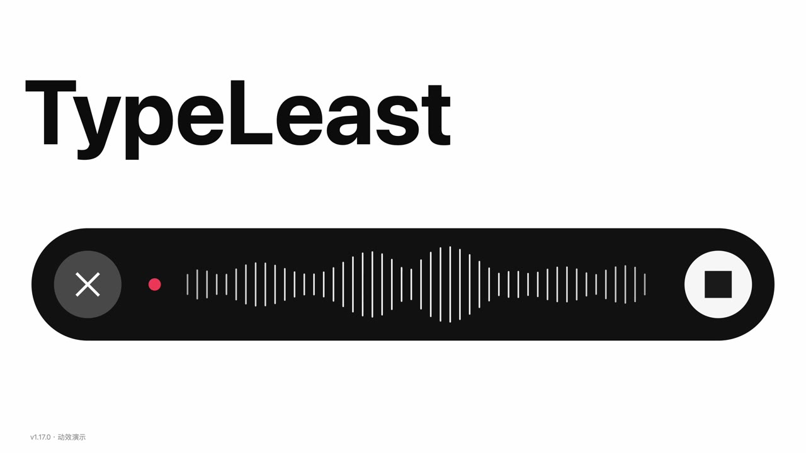</a>
  <br><sub>完整宣传片 · 点击观看</sub>
</p>

<p align="center">
  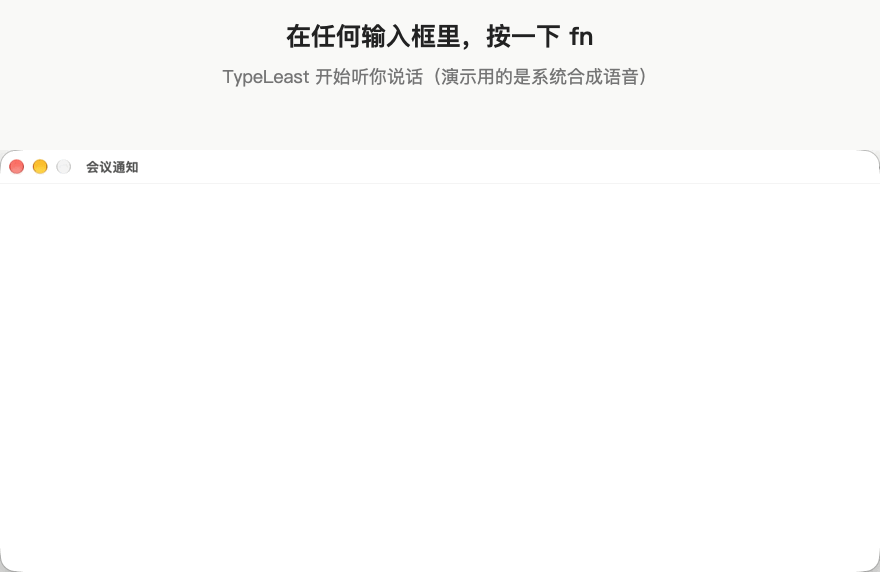
  <br><sub>真实录屏：识别、整理、粘贴，一次完成</sub>
</p>

<br>

<p align="center">
<picture>
  <source media="(prefers-color-scheme: dark)" srcset="docs/media/readme/free-dark.svg">
  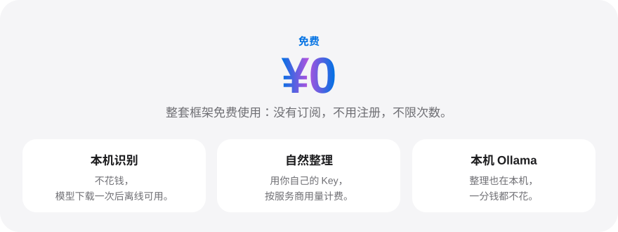
</picture>
</p>

<br>

## 界面 · macOS

<table>
  <tr>
    <td width="50%">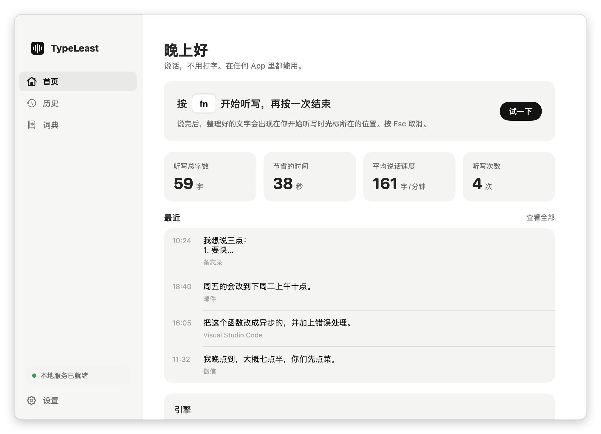</td>
    <td width="50%">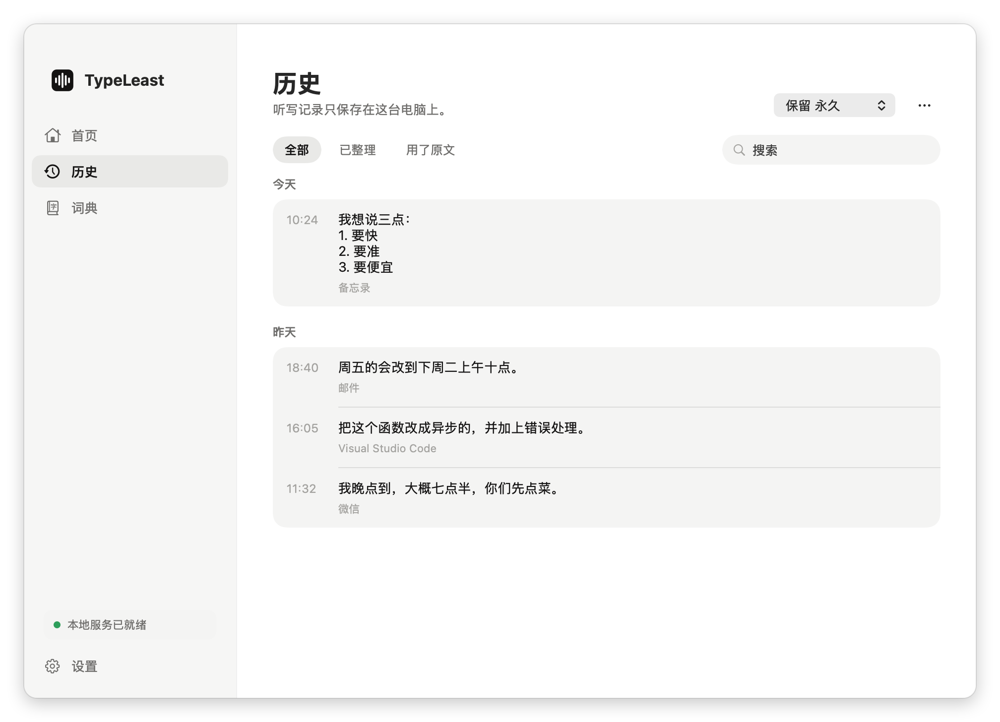</td>
  </tr>
  <tr>
    <td align="center"><sub>首页 · 一键开始、统计、最近的听写</sub></td>
    <td align="center"><sub>历史 · 整理结果和原话都能复制</sub></td>
  </tr>
  <tr>
    <td width="50%">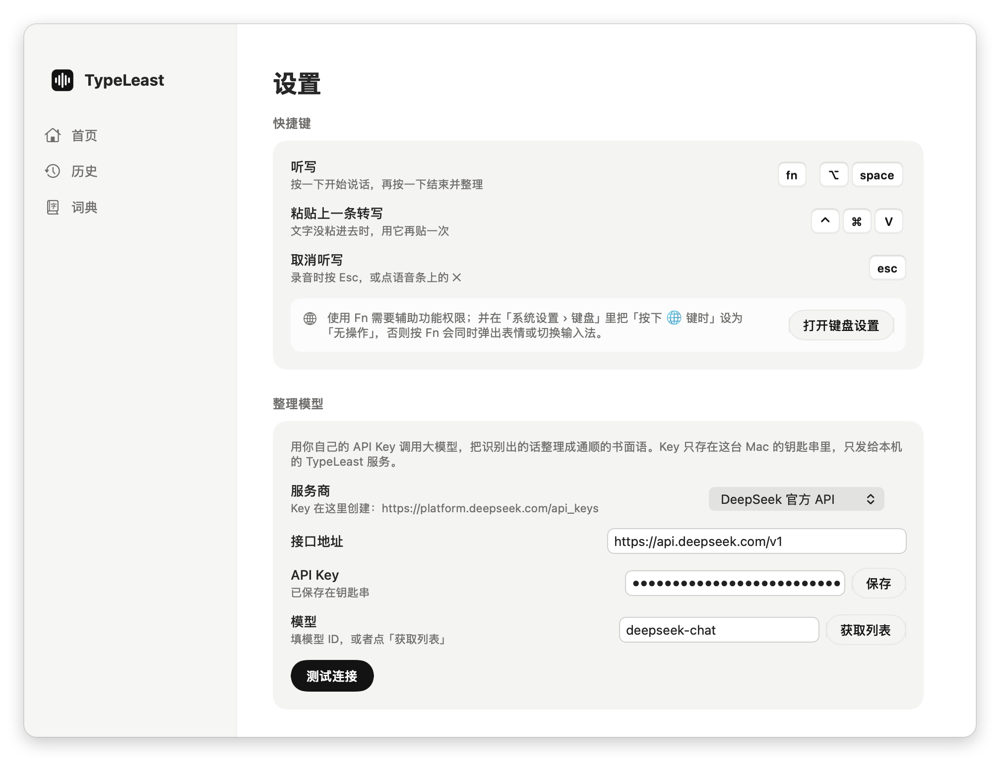</td>
    <td width="50%">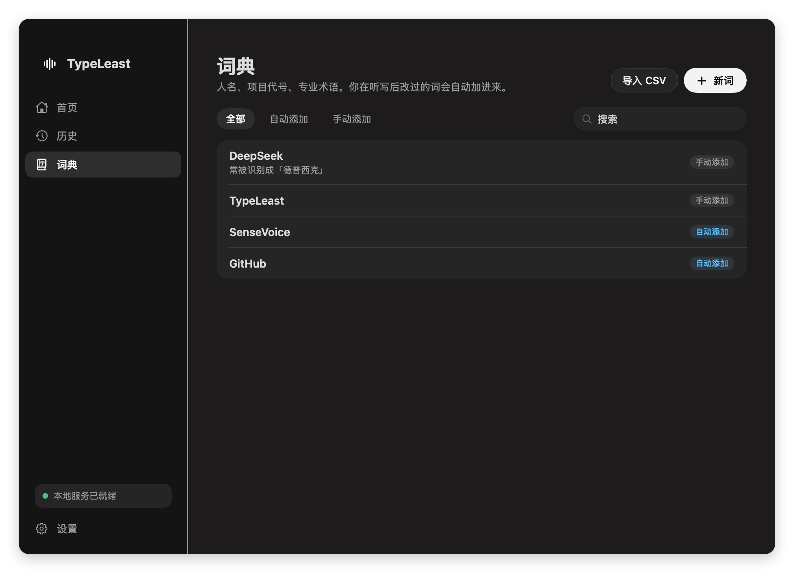</td>
  </tr>
  <tr>
    <td align="center"><sub>设置 · 选服务商、填 Key、测试连接</sub></td>
    <td align="center"><sub>词典 · 人名、术语和纠错规则，支持深色模式</sub></td>
  </tr>
</table>

<p align="center"><sub>截图里的历史和词典都是示例数据。</sub></p>

## 界面 · Windows

<p align="center">
<picture>
  <source media="(prefers-color-scheme: dark)" srcset="docs/media/windows/home-dark.png">
  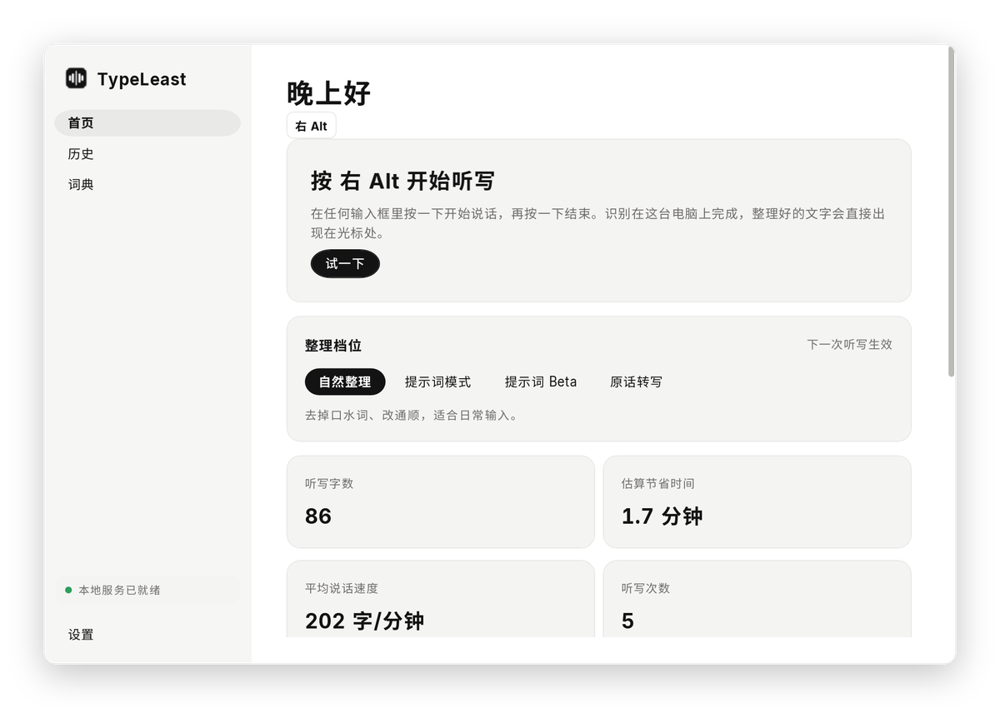
</picture>
</p>

<p align="center">
  
  <br><sub>录音条 · 圆点变红就开始收音，波形跟着声音实时起伏，整理完成自动消失</sub>
</p>

<table>
  <tr>
    <td width="50%">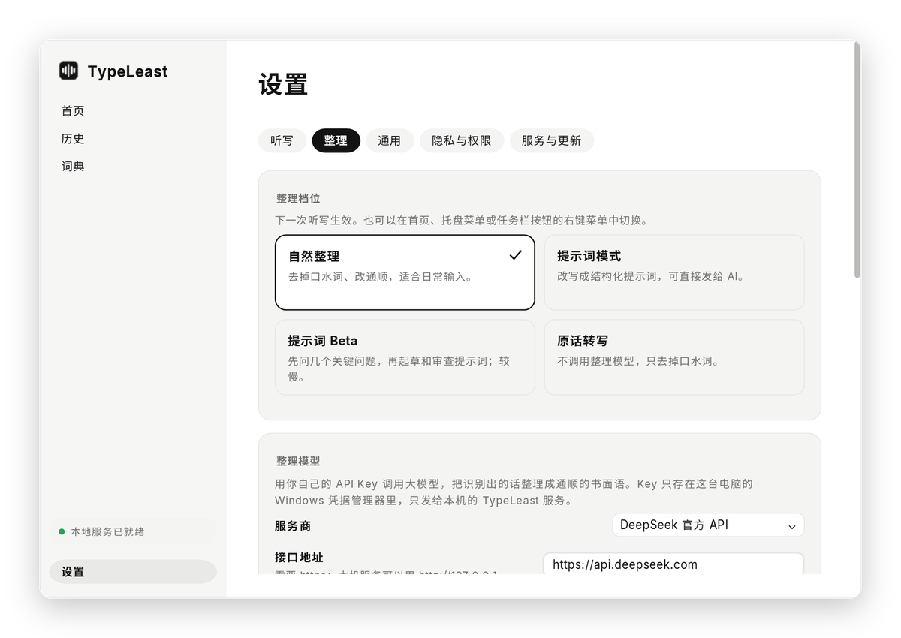</td>
    <td width="50%">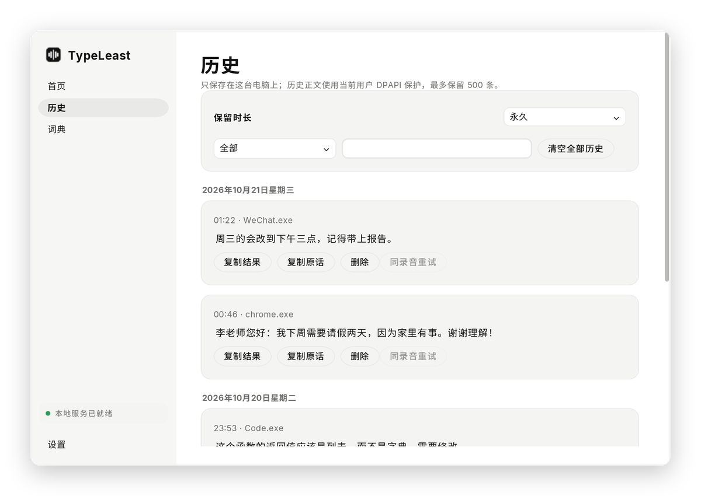</td>
  </tr>
  <tr>
    <td align="center"><sub>设置 · 整理档位一眼可选，五个标签页分好类</sub></td>
    <td align="center"><sub>历史 · 按日期分组，搜索、筛选、同一录音重试</sub></td>
  </tr>
</table>

<p align="center"><sub>Windows 界面内置开源字体 Inter 与思源黑体，跟随系统浅色和深色；截图为示例数据。</sub></p>

## 识别模型

默认用 SenseVoice Small。在「设置 → 识别模型」里点「下载并启用」，就能换成更大的本机模型：下载时照常听写，每个文件都校验 SHA-256，加载成功才切换，失败保留当前模型。

| 模型 | 适合 | 大小 |
|---|---|---|
| **SenseVoice Small** · 默认 | 小而快；中文、英文、粤语、日语、韩语 | 0.24 GB |
| **FireRedASR2 CTC** | 中文与方言，也支持英文；自动检测语言 | 0.78 GB |
| **Fun-ASR-Nano** | 中英混合听写，也支持日语 | 1.01 GB |
| **Qwen3-ASR-0.6B** | 多语言；对中文可能输出繁体字 | 0.99 GB |

<sub>这是特点不是精度排名，建议用自己的说话方式试一试。更大的模型识别更慢、占用约 2–3 GB 内存。来源和许可证见 [第三方说明](THIRD-PARTY-NOTICES.md)，实测数据见 [v1.5.0 验证记录](docs/v1.5.0-验证记录.md)。</sub>

## 下载

Mac 和 Windows 的最新版都是 [**v1.17.5**](https://github.com/FlaxXTT/Typeleast/releases/tag/v1.17.5)：

| 你的电脑 | 下载这个文件 |
|---|---|
| Mac · Apple 芯片（M1、M2、M3、M4…） | `TypeLeast-<版本>-macOS-AppleSilicon.dmg` |
| Mac · Intel 芯片 | 已停止更新，最终版是 [v1.17.1](https://github.com/FlaxXTT/Typeleast/releases/tag/v1.17.1) 的 `TypeLeast-1.17.1-macOS-Intel.dmg` |
| Windows 11 / 10（64 位） | `TypeLeast-<版本>-Windows-x64-Setup.exe`，或免安装的 `…-Portable.zip` |

<sub>不确定 Mac 是哪种芯片：点左上角  →「关于本机」，「芯片」写 Apple M… 就是 Apple 芯片。安装包已经带好运行环境，不需要另装任何东西；`SHA256SUMS.txt` 里有每个文件的校验值。</sub>

<details>
<summary><b>你需要准备的</b></summary>

| | macOS | Windows |
|---|---|---|
| 系统 | macOS 13 Ventura 或更新 | Windows 11，或 Windows 10 1809 及以上（64 位） |
| 磁盘 | 约 450 MB（App 约 200 MB + 语音模型 241 MB） | 约 450 MB（App 约 200 MB + 语音模型 241 MB） |
| 网络 | 第一次打开时下载一次语音模型（约 241 MB）；之后识别完全离线，只在整理时访问你选的模型服务商、检查更新时访问 GitHub | 同左 |
| 权限 | 麦克风；辅助功能（自动粘贴、Fn 键） | 麦克风（系统隐私设置里允许桌面应用访问）；不需要管理员权限 |
| 整理模型 | 任一 OpenAI 兼容服务的 API Key（可选） | 同左 |

</details>

<details>
<summary><b>macOS 安装步骤</b></summary>

1. 打开 `.dmg`，把 **TypeLeast** 拖进「应用程序」。
2. 第一次打开会被系统拦下，因为这个版本没有 Apple 开发者签名。打开「系统设置 → 隐私与安全性」，在页面底部点 **「仍要打开」**，再确认一次。
   也可以在「终端」里运行这一行，然后正常打开：

   ```bash
   xattr -dr com.apple.quarantine /Applications/TypeLeast.app
   ```

3. 按新手引导：
   - **本地识别**：点「下载」获取语音模型（约 241 MB，只需一次，带进度）。
   - **麦克风**：点「允许」。
   - **辅助功能**：点「授权」，在系统设置里打开 TypeLeast 的开关（用于把文字粘贴到光标处、识别 Fn 键）。
   - **🌐 / Fn 键**：建议在「系统设置 → 键盘」把「按下 🌐 键时」改为「无操作」，免得按 Fn 时同时切换输入法。
4. 在「设置 → 整理模型」里填 API Key（见下文），点「测试连接」。

</details>

<details>
<summary><b>Windows 安装步骤</b></summary>

1. 双击 `TypeLeast-<版本>-Windows-x64-Setup.exe`。安装包没有代码签名，每个新版本刚发布时都没有下载信誉：浏览器可能提示「不常下载」，选「保留」；SmartScreen 可能提示「Windows 已保护你的电脑」：点 **「更多信息」→「仍要运行」**。装好以后新版本在软件内更新，不经过浏览器，不会再有这些提示（免安装版仍要手动下载）。
2. 按向导安装（装在你自己的用户目录，不需要管理员权限），最后勾选「运行 TypeLeast」。
   - 不想安装：解压 `…-Portable.zip`，双击里面的 `TypeLeast.exe`。
3. TypeLeast 出现在任务栏右下角的托盘区（可能在「^」里）。主窗口首页会列出要完成的设置：
   - **语音模型**：点「下载（约 241 MB）」。
   - **麦克风**：如果录不到声音，打开「设置 → 隐私和安全性 → 麦克风」，打开「允许桌面应用访问麦克风」。
4. 在「设置 → 整理模型」里填 API Key，点「测试连接」。

**卸载**：Windows「设置 → 应用 → 已安装的应用」里找到 TypeLeast，点「卸载」（或在开始菜单里右键 TypeLeast →「卸载」）。卸载程序会删除程序、快捷方式和登录启动项，并询问是否同时删除设置、历史、录音、语音模型和保存的 API Key；选「否」则保留。免安装版直接删除它的文件夹即可，数据位置见下方「隐私：数据去了哪里」。

</details>

## Code signing policy

See our [Code signing policy](docs/CODE_SIGNING_POLICY.md).

Windows code signing via SignPath Foundation is currently pending approval.

## 更多

<details>
<summary><b>使用方法：快捷键、整理方式、词典</b></summary>

界面语言可在「设置 → 语言 → 界面语言」选择跟随系统、简体中文或 English，重启应用后生效。默认跟随系统：中文系统使用简体中文，其他系统使用英语。界面语言不改变听写语言或整理结果的语言。Mac 和 Windows 都支持。

| | macOS | Windows |
|---|---|---|
| 开始 / 结束听写 | 单按 **Fn（🌐）**，或 ⌥Space | 单按 **右 Alt**（可在设置里改为右 Ctrl、Caps Lock 或 F8） |
| 取消 | Esc，或点录音条上的 ✕ | 同左 |
| 粘贴上一条 | ⌃⌘V | Ctrl + Shift + V（可在设置里更换或关闭） |
| 切换整理档位 | 设置 | 首页「整理档位」卡片、托盘菜单、任务栏按钮右键菜单 |

1. 点一下任意输入框（微信、邮件、浏览器、Word、VS Code…）。
2. 按一下快捷键，屏幕底部出现录音条，开始说话。
3. 再按一下：本机识别，整理模型改写，结果粘贴到光标处。说话时切换了窗口，就只复制到剪贴板，不会贴错地方。

- **整理方式**（四档）：
  - 「自然整理」：去口水词、改通顺。Mac 与 Windows 共用维护者提供的[自然整理提示词](service/lib/prompts/cleanup.js)，这是此档位唯一的提示词来源；词典和光标上下文放在独立附录中，不改写正文。
  - 「提示词模式」：一次性理解和整理核心意图，用自然段穿插编号表达，语言简洁、严谨、专业。不输出角色、背景等固定模板，不扩展用户没提出的要求。仅在上下文和模型知识足够明确时还原术语名称，拿不准就保留描述，不联网检索。实质矛盾无法确定时，在末尾简短说明待确认之处。
    - 默认提示词不建议修改。两端「设置 → 整理 → 提示词配置（高级）」提供「打开配置文件…」，保留风险警告、再次确认和验证码；页面不显示或编辑提示词正文。
    - Mac 与 Windows 均编辑数据目录中的 `promptify.json`：`appendix` 是补充要求，`override` 是完整替换（`null` 使用默认）。保存后下一次整理生效，可在界面恢复默认。Windows 兼容旧 `promptify-system.md`：只有其修改时间晚于 JSON 时才导入，不删除旧文件。
  - 「提示词 Beta」：通过多轮补充帮助你说清背景、核心想法和期望。每次回答后都会重新检查缺失信息、矛盾和新引入的歧义，并显示当前理解供你核对。可以部分回答、纠正或继续补充；即使已经清楚，也由你点击「结束补充并生成」才出稿。只整理你表达的信息，不为凑结构补写目标或要求；未确定内容放在待确认。轮数越多，用量越高。
  - **快捷切换**：四种模式固定在主窗口内容区顶部，每个页面都可见；也可在 Mac 菜单栏和 Windows 托盘切换。录音、处理期间暂不可切换；切换离开未完成的 Beta 对话前会提醒。
  - 「原话转写」：不调用大模型，只去口水词。
- **翻译**：按翻译快捷键说话（Mac 默认 ⇧⌥Space；Windows 在设置里选一个单击键），整理后翻译成你选的语言再插入，支持英、中、日、韩、法、德、西、葡、意、俄。需要填好整理模型。
- **语言变体**：中文输出可选简体、繁体（台湾）或繁体（香港），在本机转换并换成当地用语；英文可选美式或英式拼写。
- **活动**：首页按天显示听写热力图，以及活跃天数、当前连续和最长连续天数；只记次数和字数，不记文字。
- **词典**：一定要这样写的词（人名、产品名、术语），或者「听成=正确写法」这种纠错规则，例如 `德普西克=DeepSeek`。
- **历史**：最近的听写都在主窗口「历史」里，可以复制整理结果或原话。历史在本机加密保存（Mac 钥匙串密钥、Windows 当前用户 DPAPI）；解密失败时保留原数据并提示，重置系统凭据可能导致历史无法解密。
- Windows 上，右 Alt 在部分欧洲键盘布局里是 AltGr（用来打特殊字符），这种情况请在设置里换一个键。

</details>

<details>
<summary><b>整理模型和 API Key</b></summary>

「设置 → 整理模型」里选服务商，填 Key 和模型 ID（可以点「获取列表」选），再点「测试连接」：

| 服务商 | 接口地址（已预填） | 在哪里创建 Key |
|---|---|---|
| DeepSeek 官方 | `https://api.deepseek.com` | platform.deepseek.com |
| 智谱 GLM | `https://open.bigmodel.cn/api/paas/v4` | open.bigmodel.cn |
| Kimi（月之暗面） | `https://api.moonshot.cn/v1` | platform.moonshot.cn |
| 通义千问 | `https://dashscope.aliyuncs.com/compatible-mode/v1` | dashscope.console.aliyun.com |
| OpenRouter | `https://openrouter.ai/api/v1` | openrouter.ai |
| OpenAI | `https://api.openai.com/v1` | platform.openai.com |
| 本机 Ollama | `http://127.0.0.1:11434/v1` | 不需要 Key |
| 自定义 | 任何 OpenAI 兼容地址 | — |

DeepSeek 官方当前使用模型 ID `deepseek-flash`。旧名称 `deepseek-chat`、`deepseek-reasoner` 已停用；已有用户需在设置中手动更新模型，或点「获取列表」选择。不要把 `/chat/completions` 填进接口地址，程序会自动追加这个路径。参见 [官方接入文档](https://api-docs.deepseek.com/zh-cn/) 和 [停用公告](https://api-docs.deepseek.com/zh-cn/updates/)。

- Key 保存在系统自带的安全存储里：macOS 是**钥匙串**，Windows 是**凭据管理器**，不会写进日志。整理时它只发给本机的 TypeLeast 服务，由服务直接调用你选的服务商；在设置里点「获取列表」时，App 直接向这个服务商请求模型列表。Mac 软件内更新时，旧版本在退出前把钥匙串里的 Key 直接交给新版本：先核对新版本的代码签名指纹，再通过进程间管道交接，不写入任何文件，所以更新不用再输入密码。
- 远程地址必须是 https；http 只允许本机地址（如 Ollama）。
- 会先「思考」再回答的模型（推理模型），TypeLeast 会在已知服务商上关闭思考，整理更快、更省 token。
- 调用费用由你的服务商账户承担。每次整理只发送识别出的文字和你的词典；只有你在设置里打开「参考输入框里的内容」时，才会附带光标附近的少量文字和窗口标题。

</details>

<details>
<summary><b>隐私：数据去了哪里</b></summary>

- **音频不出电脑。** 录音交给本机的识别服务，识别后即删除（Mac 会先写成系统临时文件，识别后立即删除）。打开保留录音的设置时（Mac「保留录音 24 小时」，Windows「保留录音用于重试」），录音加密保存在本机，最多 24 小时，用于重试。
- 听写结果通过系统剪贴板粘贴，之后恢复原来的剪贴板内容；剪贴板管理工具、Windows 剪贴板历史可能会记下这段文字。
- 发给整理模型服务商的只有：识别出的文字、词典，以及（打开「参考输入框里的内容」时）光标附近的文字和窗口标题；发送前会抹掉看起来像密钥、密码的内容。
- 自动学习更正（默认打开）：粘贴后最多 2 分钟内，在本机读取刚才的输入框，看你把哪个词改对了，作为「自动添加」放进词典，可以撤销。只在本机比对，不发给任何人；关掉「自动学习」就不再读取。
- 本机服务只监听 `127.0.0.1`，端口每次随机，每个请求都要带只有本机用户能读的令牌。
- 数据位置（删掉即清空）：

| | macOS | Windows |
|---|---|---|
| 设置、历史、词典、日志 | `~/Library/Application Support/TypeLeast/`、`~/Library/Logs/TypeLeast/` | `%APPDATA%\TypeLeast\` |
| 语音模型 | `~/Library/Application Support/TypeLeast/models/` | `%LOCALAPPDATA%\TypeLeast\models\` |
| API Key | 钥匙串，名称 `TypeLeast.llm-api-key` | 凭据管理器，名称以 `TypeLeast.llm-api-key/` 开头 |

</details>

<details>
<summary><b>常见问题</b></summary>

**显示「本地服务未就绪」**：在「设置 → 本地服务」点「重新启动」。从源码构建的版本需要电脑上装有 Node.js 22 或更新版本，或点「选择 Node.js…」指定位置。

**语音模型下载很慢或失败**：在「设置 → 本地服务 → 模型下载镜像」填一个 huggingface.co 的镜像地址（例如 `https://hf-mirror.com`），再点下载。每个文件都校验 SHA-256，镜像改不了内容。也可以手动下载下面三个文件，放进上面表格里的模型文件夹：

| 文件 | 放到 | 大小 |
|---|---|---|
| `https://huggingface.co/csukuangfj/sherpa-onnx-sense-voice-zh-en-ja-ko-yue-2024-07-17/resolve/main/model.int8.onnx` | `models/sensevoice/model.int8.onnx` | 239,233,841 字节 |
| `https://huggingface.co/csukuangfj/sherpa-onnx-sense-voice-zh-en-ja-ko-yue-2024-07-17/resolve/main/tokens.txt` | `models/sensevoice/tokens.txt` | 315,894 字节 |
| `https://huggingface.co/csukuangfj/vad/resolve/main/silero_vad.onnx` | `models/vad/silero_vad.onnx` | 1,807,522 字节 |

**Mac 上文字没有粘贴进去**：到「系统设置 → 隐私与安全性 → 辅助功能」确认 TypeLeast 已打开。每次更新 App 后可能需要重新打开一次。

**Mac 上按 Fn 切换了输入法**：「系统设置 → 键盘 → 按下 🌐 键时」选「无操作」。

**Windows 上录不到声音**：「设置 → 隐私和安全性 → 麦克风」，打开「麦克风访问」和「允许桌面应用访问麦克风」；在 TypeLeast「设置 → 听写 → 麦克风」里选对设备。

**Windows 上按右 Alt 没反应**：可能被别的软件占用了，或键盘布局把它当作 AltGr。在「设置 → 听写 → 快捷键」换一个键。

**Windows 上往某个程序里粘贴不进去**：Windows 不允许普通程序向「以管理员身份运行」的窗口模拟按键。文字已经在剪贴板里，按 Ctrl+V 即可；或者不要用管理员身份运行那个程序。

**杀毒软件提示 TypeLeast 有风险**：TypeLeast 用系统的键盘钩子识别单独按下的快捷键，又没有代码签名，个别杀毒软件会因此提示。它只判断快捷键和 Esc，不记录你输入的任何内容；源码就在本仓库，可以自行构建。

</details>

<details>
<summary><b>从源码构建（开发者）</b></summary>

### 前置依赖

| | macOS | Windows |
|---|---|---|
| 通用 | Git；**Node.js 22 或更新**（推荐 24 LTS，[nodejs.org](https://nodejs.org)） | 同左 |
| 编译 | Xcode 命令行工具：`xcode-select --install` | [.NET 8 SDK](https://dotnet.microsoft.com/download/dotnet/8.0) |
| 打安装包 | 系统自带的 `hdiutil`、`codesign` | [Inno Setup 6](https://jrsoftware.org/isinfo.php)（只有生成 Setup.exe 时需要）；PowerShell 7 或系统自带的 Windows PowerShell 5.1 |

### 本地服务（两个平台共用）

```bash
cd service
npm ci
npm test
npm run setup-models
npm start
```

`npm run setup-models` 下载并校验语音模型；已经有这些文件时用 `npm run setup-models -- --from <文件夹>` 导入。镜像：macOS 上 `HF_ENDPOINT=https://hf-mirror.com npm run setup-models`，Windows PowerShell 里先 `$env:HF_ENDPOINT="https://hf-mirror.com"`。

### macOS App

```bash
cd apps/macos
./test.sh
./build.sh
./package.sh arm64
```

- `./build.sh` 编译、把本地服务打进 App、安装到 `~/Applications/TypeLeast.app` 并启动（`--no-install` 只编译）。从源码构建的 App 使用电脑上已有的 Node.js。
- 软件内更新：菜单「检查更新…」或「设置 → 版本与更新」。从公开的发布页下载（发布页未公开时，用已登录的 GitHub CLI），核对 SHA-256，用本机证书重签后替换并重启。第一次更新会自动生成本机证书，macOS 会请你输入一次登录密码；之后的更新不用再输密码：钥匙串里的 Key 由旧版本交接给新版本。Intel Mac 已停止更新。
- 先运行一次 `./make-signing-cert.sh`，会在钥匙串里生成一个本机签名证书。之后每次 `./build.sh` 的签名都相同，重新编译不用再授权辅助功能和钥匙串。
- `./package.sh arm64` 生成自带 Node.js 的发布包（`.dmg` 和 `.zip`），输出在 `apps/macos/build/release/`。Intel 版已停止构建，最终版是 1.17.1。

### Windows App

```powershell
cd apps\windows
dotnet run --project TypeLeast.Core.Tests -c Release
dotnet build TypeLeast\TypeLeast.csproj -c Release
.\package.ps1
```

- 开发时让 App 使用仓库里的服务：先设置 `$env:TYPELEAST_SERVICE_DIR="<仓库路径>\service"`，再运行 `dotnet run --project TypeLeast`。
- `.\package.ps1` 生成自带 Node.js 的 `Setup.exe` 和便携版 `.zip`，输出在 `apps\windows\dist\`。

### README 里的截图、动效和演示

- 首屏动画、亮点卡片、免费卡片和按钮：`python3 docs/media/readme/make_readme_art.py` 生成浅色和深色两套 SVG（纯 SVG + CSS 动画，GitHub 直接播放）。

- Windows 截图和录音条动画：`apps/windows/Tools/MediaRenderer/make-media.sh` 用示例数据离屏渲染真实的 WPF 界面，再加圆角和阴影，输出在 `docs/media/windows/`。
- 截图：`apps/macos/Tools/render.sh` 用示例数据离屏渲染所有页面，再用 `apps/macos/Tools/demo/FrameShot.swift` 加圆角和阴影。
- 产品影片：网站首屏的动画写在 `site/film.js`。`node site/record-film.mjs` 把它逐帧录成 `docs/media/promo.mp4`、`promo.gif`、`promo-poster.jpg` 和英文版 `promo-en.mp4`（需要 Playwright 与 ffmpeg）。
- 演示 GIF：`apps/macos/Tools/demo/record-demo.sh <输出目录>`。它用 macOS 合成语音代替麦克风，走真实的识别、整理和粘贴流程，只录演示用的编辑器窗口。需要已安装、已授权辅助功能并配置好整理模型的 TypeLeast，以及运行脚本的终端有「屏幕录制」权限；录制约 20 秒，期间不要动鼠标键盘。

### 发布

托管 CI 没有额度时，在本机打包和发布：

- Windows 安装包可以在 Linux 上构建：`apps/windows/package-wine.sh`（需要 Microsoft .NET 8 SDK、Node.js 和 wine 中的 Inno Setup，用法见文件开头）；在 Windows 上用 `apps\windows\package.ps1`。
- Windows 独立发布脚本为 `apps\windows\publish-release.ps1`，默认会复制旧 Mac 包；运行前检查版本和参数。双端同步发布时，使用统一 `v<版本>` 标签和同版本的 6 个安装包，手动创建 Release 并提供更新程序需要的校验清单，不把旧 Mac 包当成新版。
- 当前 CI 与 Release 工作流只支持手动触发；推送标签不会自动打包。手动运行 Release 时指定标签，例如 `v1.17.3`；勾选 `draft` 会先建草稿，核对安装包后再手动发布。仓库公开后托管机器不占额度。

### 目录结构

| 目录 | 是什么 |
|---|---|
| [`service/`](service/) | 本地服务（Node.js）：sherpa-onnx 本地识别、调用你的模型整理、校验防编造、历史和词典；只监听 127.0.0.1 |
| [`apps/macos/`](apps/macos/) | macOS 菜单栏 App（Swift，只用系统框架） |
| [`apps/windows/`](apps/windows/) | Windows 托盘 App（C# / WPF） |
| [`docs/`](docs/) | 开发记录、发布与验证记录 |
| [`.github/workflows/`](.github/workflows/) | CI 和发布流程 |

</details>

<details>
<summary><b>许可与致谢</b></summary>

TypeLeast 以 [GNU GPL v3.0](LICENSE) 许可发布：可以自由使用、修改和再分发，修改后发布的版本也必须以 GPL-3.0 开源。

按照 GPL-3.0 第 15、16 条，TypeLeast 按「现状」提供，不附带任何担保。整理、提示词和翻译的结果由你选择的模型生成，可能出错，发送或使用前请自行核对。

见 [`THIRD-PARTY-NOTICES.md`](THIRD-PARTY-NOTICES.md)：sherpa-onnx（Apache-2.0）、SenseVoice 模型（FunAudioLLM）、Silero VAD（MIT）、Node.js（MIT）、NAudio（MIT），以及 Windows 界面字体 Inter 与思源黑体（SIL OFL 1.1）。

</details>
